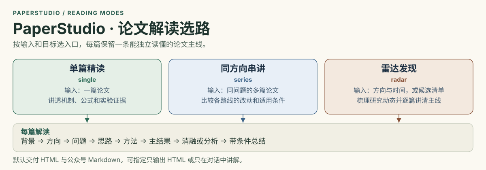
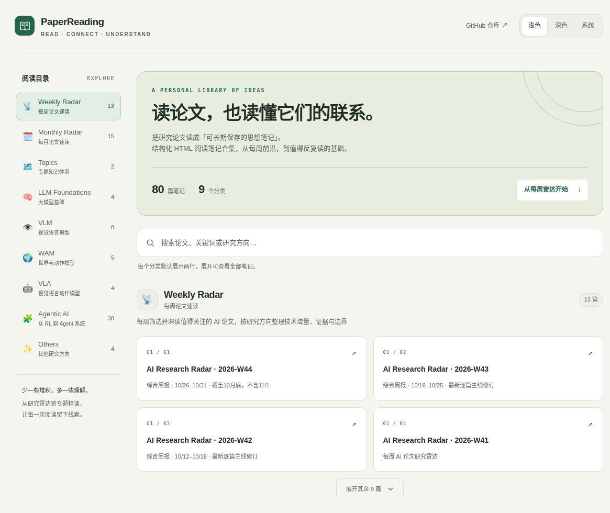
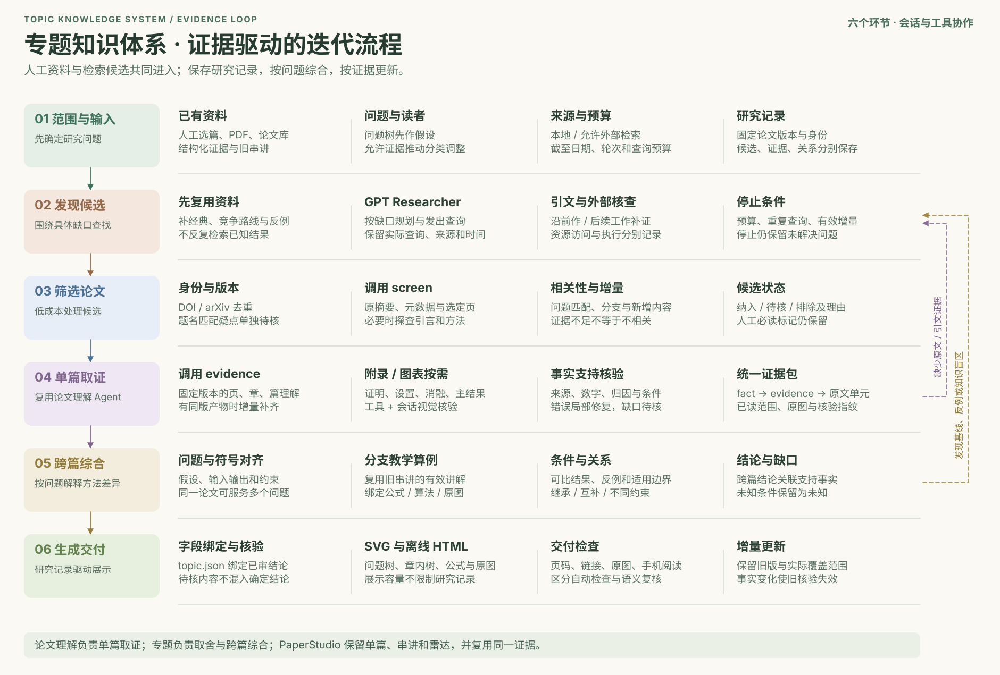
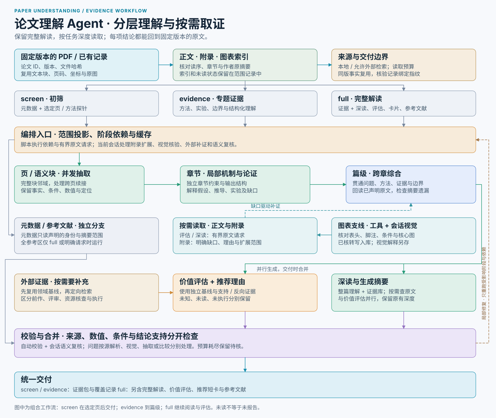

# PaperStudio

把论文讲清楚，并保存为可长期阅读的自包含 HTML；默认同时生成适合公众号编辑器的 Markdown。只保留三个入口：

| 模式 | 用途 | 展开重点 |
| --- | --- | --- |
| **单篇精读 / single** | 一篇论文的完整理解 | 结构化记录与 limu 启发的原创教学默认融合：贯穿例子、机制推演、原文论证、实验判断 |
| **同方向串讲 / series** | 同一任务/方向下的多篇工作 | 每篇完整主线，加上演进、竞争、互补或不同约束的比较 |
| **雷达发现 / radar** | 主动发现，或整理给定候选集合 | 逐篇讲通关键机制、结果与分析，重点展开方法和关键证据 |

单篇、串讲和雷达的每篇正式解读都保留：
**背景 → 方向/任务 → 问题与前作缺口 → 解决思路 → 具体方法 → 主结果 → 消融/分析结论 → 带条件总结。**

模式改变展开程度，不改变信息底线。导航卡可以短，正文必须能独立读懂。所有篇目同等覆盖，Top picks 只表示阅读顺序。



## 在线阅读与目录

[打开 GitHub Pages 阅读首页](https://linchunhui.github.io/PaperReading-skills/)。首页先展示 Weekly 和 Monthly，随后是专题知识体系与各研究方向。

<a href="https://linchunhui.github.io/PaperReading-skills/">
  <picture>
    <source media="(prefers-color-scheme: dark)" srcset="assets/reading-index-dark.jpg">
    <source media="(prefers-color-scheme: light)" srcset="assets/reading-index-light.jpg">
    
  </picture>
</a>

新版首页实景截图：侧边目录、站内搜索、两行卡片预览与浅色 / 深色主题。点击图片进入在线阅读。

| 文件夹 | 内容 | 在线入口 |
| --- | --- | --- |
| [examples/Weekly-Radar](examples/Weekly-Radar/) | 每周论文速读 | [查看目录](https://linchunhui.github.io/PaperReading-skills/#weekly-radar) |
| [examples/Monthly-Radar](examples/Monthly-Radar/) | 每月论文速读 | [查看目录](https://linchunhui.github.io/PaperReading-skills/#monthly-radar) |
| [examples/Topics](examples/Topics/) | 专题知识体系 | [查看目录](https://linchunhui.github.io/PaperReading-skills/#topics) |
| [examples/LLM-Foundations](examples/LLM-Foundations/) | 大模型基础 | [查看目录](https://linchunhui.github.io/PaperReading-skills/#llm-foundations) |
| [examples/VLM](examples/VLM/) | 视觉语言模型 | [查看目录](https://linchunhui.github.io/PaperReading-skills/#vlm) |
| [examples/WAM](examples/WAM/) | 世界与动作模型 | [查看目录](https://linchunhui.github.io/PaperReading-skills/#wam) |
| [examples/VLA](examples/VLA/) | 视觉语言动作模型 | [查看目录](https://linchunhui.github.io/PaperReading-skills/#vla) |
| [examples/Agentic_AI](examples/Agentic_AI/) | Agentic AI 教程 | [查看目录](https://linchunhui.github.io/PaperReading-skills/#agi) |
| [examples/Others](examples/Others/) | 其他研究方向 | [查看目录](https://linchunhui.github.io/PaperReading-skills/#others) |

### 专题直达

- [图像生成 · 推理加速](https://linchunhui.github.io/PaperReading-skills/examples/Topics/image-generation-acceleration/) · 72项资料、25张原图；成本口径、选型与深浅主题

- [RSI：递归自我改进](https://linchunhui.github.io/PaperReading-skills/examples/Topics/rsi-knowledge-system.html) · [SVG 知识图](https://linchunhui.github.io/PaperReading-skills/examples/Topics/rsi-knowledge-map.svg)
- [投机解码：草稿、验证与预算](https://linchunhui.github.io/PaperReading-skills/examples/Topics/speculative-decoding-topic.html) · [SVG 知识图](https://linchunhui.github.io/PaperReading-skills/examples/Topics/speculative-decoding-map.svg)

三个专题保留完整正文、内嵌论文原图与来源。公开版仅将原调研笔记的私人文件链接改为笔记名称，论文原文链接保留。历史[投机解码演化串讲](https://linchunhui.github.io/PaperReading-skills/examples/speculative-decoding-evolution.html)继续保留。

## 专题研究

| Skill | 负责 | 输出 |
| --- | --- | --- |
| [专题知识体系](skills/topic-knowledge-system/SKILL.md) | 以人工材料为种子，按缺口用 GPT Researcher 扩展，筛选后按问题综合论文 | 专题数据、SVG 问题树和离线 HTML |
| [论文理解 Agent](skills/paper-understanding-agent/SKILL.md) | 复用已有解析，或用 PyMuPDF 提取文本并按需渲染页面。按阶段抽取原摘要、方法和实验依据 | 可追溯的阶段记录或完整论文档案 |
| [PaperStudio 系列串讲](references/series.md) | 给出共同问题、贯穿算例、方法比较与适用边界。既有串讲也可作为专题的起点 | 系列讲解与可复用的比较线索 |

用 `$topic-knowledge-system` 编排专题，用 `$paper-understanding-agent` 核对单篇或补证据。两个扩展技能可独立安装，安装时保留各自的整个目录。[六步交接](skills/topic-knowledge-system/references/paper-pipeline.md) · [PDF 准备](skills/paper-understanding-agent/references/pdf-input.md)

单篇取证提供三种深度，原有完整解读继续保留：

| 取证模式 | 执行范围 | 主要用途 |
| --- | --- | --- |
| `screen` | 元数据、原摘要和选定原文页；需要时增加方法探针 | 候选筛选 |
| `evidence` | 页/语义块、章节和篇级理解；按需激活附录、核对图表 | 专题事实与比较依据 |
| `full` | 完整取证、并行深读与价值评估、参考文献、阅读卡与短卡 | 完整单篇档案 |

新流程提供范围草稿、带版本的原文读取、图像转写导入、阶段缓存、局部修复和统一证据包。来源定位、数字一致性与语义支持分别检查。专题结论绑定已核验事实后再渲染，比较时保留评测条件；缺口可反馈检索，受来源范围、轮次和查询预算约束。

[任务入口与命令](skills/paper-understanding-agent/references/research-workflow.md) · [专题研究记录与证据绑定](skills/topic-knowledge-system/references/research-record.md)

当前会话负责范围核对、视觉阅读、语义判断和外部查证；脚本负责确定性的调度、记录和校验。文本 runner 不会自动看 PNG，检索反馈也不代表已启动无人值守服务。自动校验通过不等于论文结论已被科学验证。

### 两张工作流图





## 使用

```text
使用 $paper-studio 单篇，精读 @paper.pdf，可以长一点
使用 $paper-studio 单篇，逐段讲 Method，只在对话里解释
使用 $paper-studio 同方向串讲，比较这几篇工作的机制和取舍：……
使用 $paper-studio 雷达，生成本周 OCR、VLA 和世界模型报告
使用 $paper-studio 雷达，仅整理我给的这些候选，不额外发现：……
使用 $paper-studio，把 existing-note.html 转成公众号 Markdown
使用 $paper-understanding-agent，从 @paper.pdf 抽取作者原摘要、核心方法、主结果与局限，保留 PDF 页码
使用 $paper-understanding-agent，先 screen 初筛这些论文；入选后用 evidence 核对方法与结果，按需读附录和主实验表
使用 $paper-understanding-agent，以 full 模式完整解读这篇论文，保留深读、价值评估与原文证据
使用 $topic-knowledge-system，基于这些论文和旧串讲整理 OCR 专题，允许公开检索，只补缺口，输出 HTML 和 SVG
```

一篇默认单篇；共同方向下的多篇默认串讲；研究动态发现或跨方向候选默认雷达。旧 `single-limu` 写法兼容到融合单篇，不再是可选的另一套正文。旧随笔入口已退役，按材料路由到串讲或雷达。转换已有 HTML 是交付操作，不增加阅读模式。

### 安装与更新

GitHub 的 `main` 是发布源。按需安装下列目录中的技能，保留其 `SKILL.md` 与配套文件。

| 调用名 | GitHub 安装源 |
| --- | --- |
| `$paper-studio` | [仓库根入口](SKILL.md)，配套 `agents/`、`assets/`、`references/`、`scripts/` 与 `evals/` |
| `$paper-understanding-agent` | [skills/paper-understanding-agent](skills/paper-understanding-agent/) 完整目录 |
| `$topic-knowledge-system` | [skills/topic-knowledge-system](skills/topic-knowledge-system/) 完整目录 |

更新时先比较 GitHub 发布版本与已安装版本。正式发布使用 `main`；用户指定评审分支时，完整安装该分支的技能包，记录分支和提交，不自动合并 main。仅修改 Git 不会自动替换 ChatGPT/Codex 已安装的云端技能，也不会修改既有定时任务；安装源和任务执行配置须分别更新。PaperStudio 的历史 HTML 报告可直接从示例目录阅读。独立运行论文理解 Agent 需要已配置的模型后端；专题公开扩展按来源授权和检索配置执行。

## 单篇融合了什么

保留原有的完整结构、分类/关键词/问题签名、摘要、贡献、前作关系、结果、可迁移价值和自包含交付；融入具体输入输出、贯穿例子、逐步操作、必要公式白话、关键段落论证与有条件的实验判断。以原创教学表达讲解，不冒充李沐本人或编造其评价。

解决思路回答“为什么改这个环节”，方法回答“具体如何操作”；主结果回答“整体取得了什么”，消融回答“哪些设计有效、无效、饱和或有代价”。训练与推理、观察与推测、实测与建议验证分别交代。

不设默认总字数、屏数或方法步骤配额，可以充分展开。长篇应补齐理解连接，不靠重复增加篇幅。用户指定章节、仅摘要、字数或格式时尊重其范围。

## 串讲与雷达

串讲不局限于同一作者、产品或代际系列；共同问题下的并行方案也可比较。没有证据就不画继承箭头，不同比较协议不排统一榜。

雷达每篇默认按 **背景介绍 → 问题及解决思路 → 方法 → 实验及结果 → 总结** 展开，标题可贴合论文自然措辞。问题与解决思路连起来讲，方法和关键结果重点展开；理论等论文使用相应的结果与分析标题。关键消融单独呈现，附必要数字和条件；缺失材料、未报告实验与不适用组件消融须区分。每篇均有总结，不能由全报告 recap 代替。附带稿也覆盖同一批论文。

雷达严格遵守用户方向、日期和候选来源，记录来源成功/失败/未配置状态。给定候选不暗示允许额外加篇；证据不足条目保留明确状态，不冒充完成精读。

详见 [共同主线](references/paper-storyline.md)、[单篇](references/single-paper.md)、[串讲](references/series.md)、[雷达](references/radar.md) 与 [逐篇正文](references/per-paper-deep-read.md)。

## 每次更新的生成回归

参考 SkillAdam 的任务反馈与验收思路，将以下流程写入 skill 更新规范：

**冻结基线和材料 → 独立生成基线/候选产物 → 对照原文评审 → 记录问题 → 局部修订 → 复测 → 接受或保留失败。**

```bash
python3 scripts/run_regression.py prepare \
  --baseline /path/to/baseline \
  --candidate /path/to/current-skill \
  --run-dir /path/to/new-run
# 由更新 skill 的 agent 自动派发生成任务，并安排独立证据评审
python3 scripts/run_regression.py check --run-dir /path/to/new-run
```

内置四类合成案例：复杂单篇、并行路线串讲、含材料不足条目的多篇雷达、理论论文雷达。脚本准备任务并检查案例/产物哈希/评审记录/回归门，不独立调用模型，也不能代替语义评审。不声称安装 SkillAdam 或提供常驻后台优化服务。

流程见 [更新迭代规范](references/skill-iteration.md)，案例在 [evals](evals)，本次结果见 [更新与回归记录](evals/history/2026-10-29/report.md)。一次通过仅说明这些案例未暴露相应问题，不代表所有真实论文都已验证。

## 输出与检查

默认 `{stem}.html` 与 `{stem}.wechat.md`；Markdown 图片放在 `{stem}.wechat-assets/`。用户指定只要 HTML、仅对话或其他格式时遵守。单篇 HTML 保留 PDF 原 basename，只换扩展名；串讲按方向/系列命名，雷达按日期、ISO 周或自然月命名。

HTML 位图嵌入 base64，SVG 内联，必要公式离线可渲染。Markdown 保持标准格式，适合常见公众号编辑器。

```bash
python3 scripts/embed_images.py "output.html" --in-place
python3 scripts/validate_html.py "output.html"
python3 scripts/validate_html.py "paper.html" --source-pdf "paper.pdf"
python3 scripts/html_to_markdown.py "output.html" --compact --max-chars 0
```

正式报告验收时给 `validate_html.py` 加 `--require-core-figures`。核对每篇的核心原图、出处与读图说明，或记录可核查的缺图原因。教学 SVG 用于解释关键步骤或对照机制。[核心原图规范](references/core-figures.md)

## 历史示例

[Weekly-Radar](examples/Weekly-Radar) 与 [Monthly-Radar](examples/Monthly-Radar) 保留生成时的原貌，便于回顾。历史产物不代表当前规范已全部执行；新版输出按当前主线与验收要求生成。

## License

MIT，见 [LICENSE](LICENSE)。

