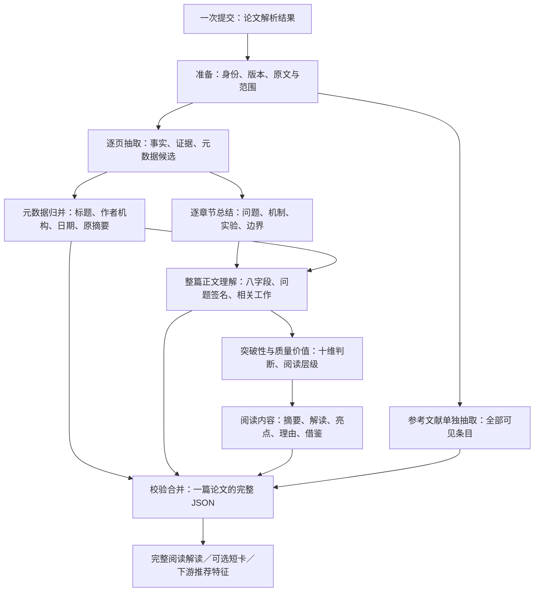

# 一个入口，分阶段处理，一份完整记录

调用方只提供一篇论文的解析结果和稳定身份；执行本 Skill 的 Agent 准备原文单元与范围清单，再使用 run_workflow.py 自动调度独立模型调用、保存、回源和合并。每页、每章、整篇理解、价值评估、阅读生成及参考文献批次分别调用；assemble_record.py 仅确定性合并，不调用模型。



## 输入和范围

每次完整流程处理一篇论文。`input.json` 使用既有规范化输入：`papers[0]` 包含 `paper_id / document_version_id / coverage / units`，每个单元保留 `unit_id / text / origin / locator / source_type`。多篇论文由外层逐篇调度。`options.profile=comprehensive`，默认全部十维；明确的局部任务另行执行，不标记为完整流程。

先保留原始解析结果，再制作下面的范围清单。解析器没有页码或章节时，使用 `chunk-*`、`unsectioned-*` 这样的显式逻辑分组，在 `boundary_notes` 说明，不能猜造页号或章节标题。

- `main_unit_ids`：本次声明的分析原文，默认标题、作者、摘要与正文；宿主显式激活的附录会并入派生范围并保留任务覆盖记录。
- `metadata_source_unit_ids`（可选）：元数据实际读取的正文/元数据单元，必须包含已声明的摘要跨度；未设时保留旧版全正文行为。
- `metadata_unit_ids`（可选）：正文之外实际包含作者／贡献者、机构或日期的单元，只用于元数据，独立于正文范围。
- `reference_unit_ids`：完整参考文献区域，包括跨页续接。不能先截断正文再把这个截断文件传给参考文献阶段。
- `excluded_units=[{unit_id,reason}]`：附录、致谢、版权说明等；仍保留原文，不输入默认正文总结。
- `external_unit_ids`：明确提供的前作、评审、回应、链接核查或执行记录，供评估使用；不能升级成本文事实。
- `unresolved_units=[{unit_id,reason}]`：边界仍不确定的材料，不悄悄归入正文，最终保持 partial。
- `pages=[{page_id,unit_ids}]`、`sections=[{section_id,title,unit_ids}]`：正文的两套分组。每套分组分别覆盖全部正文单元且不重复；题名作者摘要可放在 `frontmatter`。页与章节之间可以多对多。
- `original_abstract_spans=[{unit_id,quote}]`：按原始顺序保存摘要的逐块原文。`metadata.original_abstract` 等于这些 quote 用一个换行连接；不改写、不翻译。没有原始摘要时为 null 并写明原因。
- `boundary_notes`：边界依据、片段拆分映射、缺页及其他影响处理范围的说明。

以上各类单元必须互斥且覆盖全部输入单元。参考文献或附录与结论在同一页／块时，先按字符范围拆分，保留 `locator.parent_unit_id / start / end`；不能把整页当参考文献而漏掉结论。截断、输入缺页或仅有摘要都保持真实 coverage。

## 内部阶段

| kind | 模型调用的输入 | data 产物 | 归并要求 |
|---|---|---|---|
| page（每页／片段一次） | 目标页正文单元、必要相邻上下文 | `page_id, metadata_candidates, summary, open_links` | 候选含 `field,value,fact_ids`；页摘要是 claim 数组；事实留原文定位，不提前做全篇判断 |
| metadata（独立一次） | 已声明的 metadata_source_unit_ids，默认前置信息与摘要 | `metadata` | 按原文顺序完整作者、机构与明确对应、日期及类型精度、venue、IDs、资源、原始摘要；冲突不静默覆盖。正式作者行与贡献名单分开，贡献者存 contributors。references 先为空 |
| section（每章一次） | 该章原文、相关页事实及跨页续接信息 | `section_id,title,summary,open_questions` | summary 为 claim 数组，保留机制与实验条件；不能只拼接页摘要 |
| understanding（一次） | 全部章节结果、正文事实库、可回查正文及元数据 | `understanding` | 八字段、问题签名、相关工作差分；核心贡献、关键结果与限制不能在逐层压缩中丢失 |
| assessment（与深读并行） | 整篇理解、事实、可选外部证据；按需回查原文 | `assessments, assessment_summary, recommendations` | 十维逐项有依据、边界和缺口；形成阅读层级，不把作者自称创新或会议录用当质量真值 |
| reading（与评估并行） | 整篇理解和同一证据库；按需回查原文 | `reuse_cards,insight_rules,glossary,display,content_products`；`recommendations` 留空 | 生成摘要、深度解读、首页摘要与贡献亮点；推荐理由由 assessment 产生，在交付时合并 |
| references（独立一次或分批归并） | 全部 reference 单元及续接上下文 | `references,unparsed_segments,excluded_segments` | 每个可见引文出现保留为独立条目，跨页不重复；完整保留原始引文，未知字段留空 |

每个阶段的 evidence、facts 可以新增或复用既有 ID；同 ID 必须完全同值。引用上游事实不必重复复制定义。`source_unit_ids` 是本阶段覆盖的原始单元，`context_unit_ids` 是仅供衔接的单元。page 的事实至少关联一个目标单元；仅来自邻页的事实交回所属页。

正文理解与章节总结使用正文证据。参考文献条目能证明“本文列出了这篇文献”，不能单独证明前作的方法、效果或本文的创新。需要独立前作比较时使用明确的 prior_work 输入。附录补充证据由带理由的范围扩展处理，派生清单保留已读与未读单元；不能把未读理解为论文未报告。

## 阶段文件与清单

每个阶段单独写一个 JSON：

```json
{
  "stage_id": "page-p1",
  "kind": "page",
  "paper_id": "caller-paper-id",
  "document_version_id": "caller-version",
  "input_sha256": "由 assemble_record.py --input-hash INPUT 得到",
  "status": "complete",
  "producer": {"skill_revision":"2.0", "model":"实际执行模型", "prompt_version":"实际提示版本"},
  "source_unit_ids": ["p1-b1"],
  "context_unit_ids": [],
  "evidence": [],
  "facts": [],
  "missing_information": [],
  "limitations": [],
  "data": {"page_id":"p1", "metadata_candidates":[], "summary":[], "open_links":[]}
}
```

以上是结构模板，空内容不表示有效抽取；可核验的事实及页摘要必须由模型实际处理后填入。`status=complete|partial` 描述阶段处理覆盖；任务执行失败另存错误，不交给合并器冒充成功。无参考文献材料时仍完成 references 阶段的缺失说明；存在未解析条目时 status=partial。

`manifest.json`：

```json
{
  "paper_id": "caller-paper-id",
  "document_version_id": "caller-version",
  "input_sha256": "同一输入指纹",
  "scope": {
    "main_unit_ids":["p1-b1"], "reference_unit_ids":[],
    "excluded_units":[], "external_unit_ids":[], "unresolved_units":[],
    "pages":[{"page_id":"p1","unit_ids":["p1-b1"]}],
    "sections":[{"section_id":"frontmatter","title":"题名与摘要","unit_ids":["p1-b1"]}],
    "original_abstract_spans":[], "boundary_notes":[]
  },
  "stages":[{"stage_id":"page-p1","kind":"page","path":"stages/page-p1.json"}]
}
```

清单必须列出每个 page、section 及各一个 metadata、understanding、assessment、reading、references 阶段，不能仅使用上面的单条示意。路径相对 manifest 所在目录。合并器记录实际阶段文件 SHA256，并拒绝缺阶段、冲突 ID、跨版本结果及范围混用。

## 完整交付和断点继续

```text
input.json                       原始单元、身份和覆盖
manifest.json                    内部阶段及范围清单
stages/*.json                    可复用的中间产物
paper-record.json                对外一份完整记录，schema_version=2.0
paper-card.md                    默认完整阅读解读，读取全部deep_read段落
paper-short-card.md              可选精简卡，使用display选择
validation.json                 结构／来源／范围校验结果
```

Agent 内部执行：

```bash
python3 scripts/assemble_record.py --input-hash input.json
python3 scripts/assemble_record.py input.json manifest.json paper-record.json --report validation.json
python3 scripts/render_card.py paper-record.json paper-card.md --mode detailed
python3 scripts/render_card.py paper-record.json paper-short-card.md --mode compact
```

完整流程命令：

```bash
python3 scripts/run_workflow.py --input input.json --manifest manifest.json --out output --skill-root /absolute/path/to/paper-understanding --model MODEL --reasoning-effort low --concurrency 2
```

模型设置由实际运行环境明确指定；保存每次CLI原始JSONL、最终响应、thread_id、token usage及输入/上游指纹。调用次数以真实turn.completed事件计数，重试单列；阶段文件数不能替代调用数。run_workflow.py可按stage或stage-id恢复，缓存还须匹配原文、范围、Skill、模型与上游及真实调用凭据。

主 JSON 保留原来的内容字段，并增加 `page_extractions / section_summaries / assessment_summary / content_products / bibliography / workflow`。schema 位于 `workflow-output.schema.json`。参考文献完整内容位于 `metadata.references`，无需下游再拼一个 references 文件。

失败只重跑对应阶段及依赖它的下游。元数据与参考文献可独立修复；页事实变化需重新判定涉及的章节、正文理解、评估和阅读内容是否失效。缓存需比对输入指纹、范围清单、上游产物指纹和 producer；合并器只验证当前输入身份与阶段文件，不替代缓存调度器。

输入缺失或阶段 partial 时仍能交付带缺口的统一记录，不能填造未知事实。所有阶段有结果并通过校验也只代表流程与结构完整；原文是否支持语义、章节要点是否遗漏，仍按[要点评测规程](evaluation.md)单独评估。

当前运行器在 assessment/reading 支持有界 source-read 请求，最多两次，每次 16000 字符；不向模型开放任意工具。校验重试仍限两次内容尝试。推荐理由由 assessment 产生，reading 不依赖 assessment；合并保留各自阶段来源。
